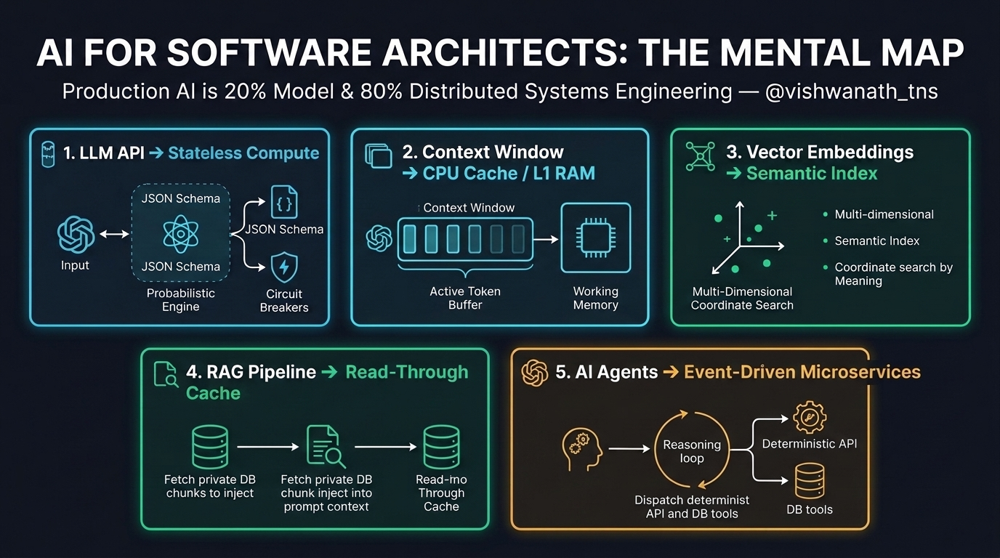

# AI for Software Architects — Hands-On Labs

**By Vishwanath S** | Lead Software Architect (26+ Yrs) | BITS Pilani  
🐦 **Follow the daily series on X:** [@vishwanath_tns](https://x.com/vishwanath_tns)



---

## Why This Repository Exists

Most AI tutorials start by making you install 15 bloated libraries that hide what is actually happening on the wire. 

If you are an experienced **Software Engineer, Backend Developer, or Distributed Systems Architect**, you don't need hype—you need to see how LLMs, Context Windows, Vector Embeddings, RAG, and AI Agents map to the **systems engineering patterns you already know**.

> **Core Thesis:** *Production AI is 20% Machine Learning and 80% Distributed Systems Architecture.*

Each lab in this repository uses **minimal, zero-bloat code** so you can inspect the raw wire protocols, JSON contracts, latency budgets, and failure modes.

---

## Hands-On Labs Curriculum

| Lab | Topic | Systems Architecture Equivalent | Status |
| :--- | :--- | :--- | :--- |
| **[Lesson 01](./Lesson_01_How_LLMs_Actually_Work/)** | **Under the Hood of an LLM Call** (Raw HTTPS, `temperature=0.0`, Strict JSON Schema) | Stateless REST Microservice + Protobuf/JSON Schema Validation | ✅ Ready |
| **Lesson 02** | **Prompt Caching, Retries & Circuit Breakers** | L1/L2 Caching + Resilience4j Fault Tolerance | 🔜 Next |
| **Lesson 03** | **Vector Embeddings & Semantic Search from Scratch** | Multi-Dimensional B-Tree / Coordinate Indexing | 🔜 Planned |
| **Lesson 04** | **Production RAG (Retrieval-Augmented Generation)** | Read-Through Query Cache & Data Pipeline | 🔜 Planned |
| **Lesson 05** | **Event-Driven AI Agents & Tool Calling** | Kafka Consumers + Dynamic LLM Router Calling Deterministic APIs | 🔜 Planned |

---

## Quick Start: Run Lesson 01 (Zero Dependencies!)

Lesson 01 uses **pure Python 3.11+ standard library** (`urllib.request` + `json`—no `pip install` needed!) to turn a messy **Customer Online Order & UPI Payment Complaint** into a strictly-typed JSON ticket ready for your backend database or Kafka queue.

```bash
# 1. Clone the repository
git clone https://github.com/vishwanath-tns/ai-for-software-architects.git
cd ai-for-software-architects

# 2. Run in Simulation Mode (inspects the raw HTTP JSON contract immediately)
python Lesson_01_How_LLMs_Actually_Work/lesson1_architect_ai_demo.py

# 3. Optional: Run against Live Google Gemini API (Free API Key from https://aistudio.google.com/apikey)
# PowerShell:
$env:GEMINI_API_KEY="your_api_key_here"
python Lesson_01_How_LLMs_Actually_Work/lesson1_architect_ai_demo.py
```

---

## License
MIT License — Free to use, fork, and share for learning!

